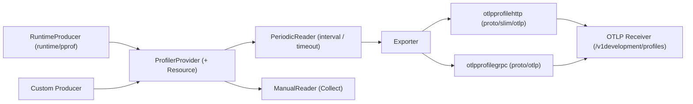

# Profiles SDK

## Abstract

`go.opentelemetry.io/otel/sdk/profile` provides an experimental Go Profiles SDK and built-in Go runtime profiler targeting the Alpha [OpenTelemetry Profiles specification](https://github.com/open-telemetry/opentelemetry-specification/blob/main/specification/profiles/README.md) (`v1development`).

This design is part of [#8449](https://github.com/open-telemetry/opentelemetry-go/issues/8449). The prototype stack lives in:

- [#9545](https://github.com/open-telemetry/opentelemetry-go/pull/9545): `go.opentelemetry.io/otel/sdk/profile` and `go.opentelemetry.io/otel/sdk/profile/profiledata`
- [#9546](https://github.com/open-telemetry/opentelemetry-go/pull/9546): `go.opentelemetry.io/otel/exporters/otlp/otlpprofile/otlpprofilehttp`
- [#9547](https://github.com/open-telemetry/opentelemetry-go/pull/9547): `go.opentelemetry.io/otel/exporters/otlp/otlpprofile/otlpprofilegrpc`

## Background

Out-of-process eBPF profilers such as [opentelemetry-ebpf-profiler](https://github.com/open-telemetry/opentelemetry-ebpf-profiler) collect low-overhead CPU profiles across hosts without code changes, but cannot capture Go runtime profiles cheaply: live heap (`inuse_space`, `inuse_objects`), allocation rates (`alloc_space`, `alloc_objects`), goroutine stacks, mutex contention, and blocking profiles.

The Go Profiles SDK fills that gap with four design goals:

- Collect live heap, interval-delta allocations, and goroutine snapshots by default without mutating global Go runtime profiling rates or claiming the single process-wide CPU profiler.
- Keep `go.opentelemetry.io/otel/sdk/profile` free of protobuf and third-party dependencies, and keep `otlpprofilehttp` free of `google.golang.org/grpc` by using `go.opentelemetry.io/proto/slim/otlp`.
- Reuse the pull-oriented `Provider`, `Producer`, `Reader`, and `Exporter` architecture from `go.opentelemetry.io/otel/sdk/metric`, sealed `Option` interfaces, and existing OTLP exporter patterns.
- Emit deduplicated, orphan-free `ProfilesDictionary` payloads that pass [sig-profiling/profcheck](https://github.com/open-telemetry/sig-profiling/tree/main/profcheck).

## Module structure

Modules use singular `profile` to match `sdk/trace`, `sdk/metric`, `sdk/log`, and `exporters/otlp/otlp{trace,metric,log}`. All profiling modules start in the `v0.0.0` experimental module set in `versions.yaml`.

SDK module:

- `go.opentelemetry.io/otel/sdk/profile`: `ProfilerProvider`, `Producer`, `RuntimeProducer`, `Reader`, `ManualReader`, `PeriodicReader`, `Exporter`
- `go.opentelemetry.io/otel/sdk/profile/profiledata`: protobuf-free SDK profile data model

Exporter modules:

- `go.opentelemetry.io/otel/exporters/otlp/otlpprofile/otlpprofilehttp`
- `go.opentelemetry.io/otel/exporters/otlp/otlpprofile/otlpprofilegrpc`
- Future: `go.opentelemetry.io/otel/exporters/stdout/stdoutprofile`

## Pipeline architecture



## Data model (`profiledata`)

`go.opentelemetry.io/otel/sdk/profile/profiledata` mirrors the OTLP Profiles `v1development` hierarchy without exposing protobuf generated types in the SDK API:

- `ResourceProfiles` holds `*resource.Resource` and `[]ScopeProfiles`.
- `ScopeProfiles` holds `instrumentation.Scope` and `[]Profile`.
- `Profile` holds `SampleType`, `Samples`, `Time`, `Duration`, `PeriodType`, `Period`, `ProfileID`, `DroppedAttributesCount`, `OriginalPayloadFormat`, `OriginalPayload`, and `Attributes`.
- `Sample` holds `Stack []*Location`, `Values []int64`, `Timestamps []time.Time`, `Attributes []Attribute`, and `Link`.
- `Location`, `Mapping`, `Line`, `Function`, `ValueType`, `Link` (`trace.TraceID`, `trace.SpanID`), and `Attribute` (`attribute.Key`, `attribute.Value`, optional UCUM `Unit`).

`profiledata.Attribute` reuses `go.opentelemetry.io/otel/attribute` for keys and structured `attribute.Value` (matching `go.opentelemetry.io/otel/sdk/log`) while adding the optional UCUM `Unit` field required by OTLP `KeyValueAndUnit`. `Location` and `Mapping` are shared pointers within a batch so exporters can cache dictionary indices by pointer identity before falling back to content deduplication.

## ProfilerProvider

`ProfilerProvider` coordinates a single `*resource.Resource` (defaulting to `resource.Default()`), registered `Producer` instances, and registered `Reader` instances:

```go
type ProfilerProvider struct { /* ... */ }

func NewProfilerProvider(options ...Option) *ProfilerProvider
func (*ProfilerProvider) ForceFlush(ctx context.Context) error
func (*ProfilerProvider) Shutdown(ctx context.Context) error

type Option interface { /* unexported */ }
func WithResource(res *resource.Resource) Option
func WithReader(r Reader) Option
func WithProducer(p Producer) ProducerOption
```

`Shutdown` is idempotent (`sync.Once`). It shuts down readers first so their final collection and export can read from provider-level producers, then shuts down producers implementing `Shutdown(context.Context) error`.

## Producer and RuntimeProducer

`Producer` is the single-method extension point for profile sources:

```go
type Producer interface {
	Produce(ctx context.Context) ([]profiledata.ScopeProfiles, error)
}
```

Producers that hold runtime state may also implement `Shutdown(context.Context) error`, which `ProfilerProvider` and readers invoke during shutdown. `WithProducer(p)` returns a `ProducerOption` accepted by `ProfilerProvider`, `ManualReader`, and `PeriodicReader`, matching `sdk/metric.WithProducer`.

`RuntimeProducer` collects profiles from Go's `runtime/pprof` and decodes them with an internal zero-dependency pprof wire decoder (`sdk/profile/internal/pprof`):

```go
type RuntimeProducer struct { /* ... */ }

func NewRuntimeProducer(opts ...RuntimeProducerOption) *RuntimeProducer
func (*RuntimeProducer) Produce(ctx context.Context) ([]profiledata.ScopeProfiles, error)
func (*RuntimeProducer) Shutdown(ctx context.Context) error

type RuntimeProducerOption interface { /* unexported */ }
func WithHeapProfile() RuntimeProducerOption
func WithoutHeapProfile() RuntimeProducerOption
func WithAllocsProfile() RuntimeProducerOption
func WithoutAllocsProfile() RuntimeProducerOption
func WithGoroutineProfile() RuntimeProducerOption
func WithoutGoroutineProfile() RuntimeProducerOption
func WithMutexProfile() RuntimeProducerOption
func WithMutexProfileFraction(fraction int) RuntimeProducerOption
func WithBlockProfile() RuntimeProducerOption
func WithBlockProfileRate(rate int) RuntimeProducerOption
func WithCPUProfile() RuntimeProducerOption
func WithoutDeltaProfiles() RuntimeProducerOption
```

| Profile kind | Default | Mode | Scope suffix | Runtime side effects |
| :--- | :--- | :--- | :--- | :--- |
| Live heap (`inuse_space`, `inuse_objects`) | Enabled | Instantaneous snapshot | `.../runtime/heap` | None |
| Allocations (`alloc_space`, `alloc_objects`) | Enabled | Interval delta (opt-out via `WithoutDeltaProfiles`) | `.../runtime/allocs` | None |
| Goroutines | Enabled | Instantaneous snapshot | `.../runtime/goroutine` | None |
| Mutex contention | Opt-in (`WithMutexProfile` / `WithMutexProfileFraction`) | Interval delta | `.../runtime/mutex` | Refcounted `runtime.SetMutexProfileFraction`, restored on `Shutdown` |
| Blocking | Opt-in (`WithBlockProfile` / `WithBlockProfileRate`) | Interval delta | `.../runtime/block` | Refcounted `runtime.SetBlockProfileRate`, reset on `Shutdown` |
| CPU | Opt-in (`WithCPUProfile`) | Double-buffered continuous window | `.../runtime/cpu` | Claims process-wide `pprof.StartCPUProfile`, stopped on `Shutdown` |

Implementation invariants in `RuntimeProducer` and `sdk/profile/internal/pprof`:

- `BuildIDCache` reads and caches `process.executable.build_id.htlhash`, Go build ID, and GNU ELF build ID per binary path per [Profiles Mappings Attributes](https://github.com/open-telemetry/opentelemetry-specification/blob/main/specification/profiles/mappings.md).
- Converted profiles emit `pprof.scope.default_sample_type`, `pprof.scope.sample_type_order`, `profile.frame.type = "go"`, and `pprof.mapping.*` attributes per [Pprof Compatibility](https://github.com/open-telemetry/opentelemetry-specification/blob/main/specification/profiles/pprof.md).
- Samples carrying valid `otel.trace_id` and `otel.span_id` pprof labels convert to `profiledata.Link` and drop those raw labels from sample attributes.
- Global mutex and block profiling rate updates are reference-counted across `RuntimeProducer` instances so shutting down one instance does not prematurely disable profiling for another.

## Reader, ManualReader, and PeriodicReader

`Reader` mirrors `sdk/metric.Reader` with an unexported `register` method plus `Collect`, `ForceFlush`, and `Shutdown`:

```go
type Reader interface {
	register(sdkProducer)
	Collect(ctx context.Context, rp *profiledata.ResourceProfiles) error
	ForceFlush(ctx context.Context) error
	Shutdown(ctx context.Context) error
}
```

- `ManualReader` supports on-demand collection in tests and custom pull pipelines.
- `PeriodicReader` runs a single background goroutine ticking on `WithInterval` (default `60s`) with per-cycle `WithTimeout` (default `30s`). `ForceFlush` triggers an immediate collect-and-export cycle and resets the ticker. `Shutdown` stops the loop, runs one final collect-and-export cycle, shuts down reader-attached producers, and shuts down the `Exporter`.

## Exporter and OTLP transport

```go
type Exporter interface {
	Export(ctx context.Context, rp *profiledata.ResourceProfiles) error
	ForceFlush(ctx context.Context) error
	Shutdown(ctx context.Context) error
}
```

Implementations must honor `ctx` cancellation and deadlines and must not retain `rp` after `Export` returns.

Both `otlpprofilehttp` and `otlpprofilegrpc` generate their `internal/transform` package from a single shared `gotmpl` template (`internal/shared/otlp/otlpprofile/transform/profile.go.tmpl`), parameterized by `protoRoot` (`go.opentelemetry.io/proto/slim/otlp` for HTTP and `go.opentelemetry.io/proto/otlp` for gRPC):

- Dictionary invariants: index 0 of all seven tables (`StringTable`, `MappingTable`, `LocationTable`, `FunctionTable`, `LinkTable`, `AttributeTable`, `StackTable`) holds the zero-value sentinel. Entries are deduplicated by canonical OTLP wire representation (including across Go slice `attribute.Type` variants) and kept orphan-free. String keys and values use dictionary references (`KeyStrindex`, `StringValueStrindex`).
- `otlpprofilehttp` posts to `/v1development/profiles` on `localhost:4318` by default, sets `Content-Type: application/x-protobuf` and `OTLP-Profiles-Development-Version: 1`, reads `OTEL_EXPORTER_OTLP_PROFILES_*` with fallback to `OTEL_EXPORTER_OTLP_*`, supports gzip, `Retry-After` retries (`429`, `502`, `503`, `504`), partial-success (`rejected_profiles`) reporting, 64 MiB default max request size (checked via `proto.Size` before marshaling), and 4 MiB max decompressed response size.
- `otlpprofilegrpc` shares the same environment variables, sends `otlp-profiles-development-version: 1` gRPC metadata, and supports TLS/mTLS, gzip, `RetryInfo` throttling, and partial-success reporting.

## Trace context correlation

`sdk/profile/internal/pprof.Convert` already parses `otel.trace_id` and `otel.span_id` pprof labels into `profiledata.Sample.Link`, while `RuntimeProducer` does not automatically write goroutine pprof labels when spans start.

Two complementary mechanisms cover trace correlation in Go:

1. In-process pprof labels (planned follow-up): an opt-in helper or `sdk/trace` integration that attaches `otel.trace_id` and `otel.span_id` via `runtime/pprof.Do` or `runtime/pprof.SetGoroutineLabels` on span start/end. Stdlib `runtime/pprof` currently attaches goroutine labels to CPU and goroutine profiles, not heap, allocs, mutex, or block profiles.
2. Out-of-process context sharing ([OTEP 4719](https://github.com/open-telemetry/opentelemetry-specification/blob/main/oteps/profiles/4719-process-ctx.md) / [spec PR #5370](https://github.com/open-telemetry/opentelemetry-specification/pull/5370) and [OTEP 4947](https://github.com/open-telemetry/opentelemetry-specification/blob/main/oteps/profiles/4947-thread-ctx.md)): `ProcessContext` publishes process `Resource` for eBPF profilers, while `ThreadContext` uses ELF TLS, which does not directly map to Go's M:N goroutine scheduler without runtime hooks. Keeping `sdk/profile` decoupled lets both evolve independently.

## Cross-language alignment and OTel specification

[`opentelemetry-specification/specification/profiles/`](https://github.com/open-telemetry/opentelemetry-specification/tree/main/specification/profiles) currently covers the wire data format, mapping attributes, pprof compatibility, and open PRs for well-known `sample_type`/`period_type` values ([#5409](https://github.com/open-telemetry/opentelemetry-specification/pull/5409)) and Process Context Sharing ([#5370](https://github.com/open-telemetry/opentelemetry-specification/pull/5370)). There is no Profiles SDK specification yet.

Comparing this design with [OTel .NET's `ContinuousProfiler`](https://github.com/open-telemetry/opentelemetry-dotnet-instrumentation/tree/main/src/OpenTelemetry.AutoInstrumentation/ContinuousProfiler) and [`PluginApi/ContinuousProfiling`](https://github.com/open-telemetry/opentelemetry-dotnet-instrumentation/tree/main/src/OpenTelemetry.AutoInstrumentation.PluginApi/ContinuousProfiling) highlights what belongs in an upstream OTel specification versus language SDKs:

| Dimension | OTel Go `sdk/profile` | OTel .NET `ContinuousProfiler` | OTel eBPF Profiler | Upstream OTel Spec candidate |
| :--- | :--- | :--- | :--- | :--- |
| Pipeline lifecycle | `ProfilerProvider`, `Producer`, `Reader` (`PeriodicReader` / `ManualReader`), `Exporter` | `ContinuousProfilerManager`, `SampleExporter` loop, `BufferProcessor`, `IContinuousProfilerExporter` | eBPF ring buffer to collector pipeline | Yes: `ProfilerProvider`, `ProfileReader`, `ProfileProducer`, `ProfileExporter`, `ForceFlush`, `Shutdown` |
| Scheduling knobs | `interval` (`60s`), `timeout` (`30s`) | Per-sample-type `ExportInterval`, `ExportTimeout` | Collection interval | Yes: `OTEL_PROFILES_EXPORTER`, `OTEL_PROFILES_EXPORT_INTERVAL`, `OTEL_PROFILES_EXPORT_TIMEOUT` |
| Exporter input | Typed `profiledata.ResourceProfiles` | Raw native `byte[]` buffers | OTLP `Profiles` | Yes: OTLP-aligned typed profile data model |
| Runtime profile knobs | `heap`, `allocs`, `goroutine`, opt-in `mutex` fraction, `block` rate, `cpu`, delta flag | `ThreadSamplingInterval`, `MaxAllocationSamplesPerMinute`, `SelectedThreads` | Perf events | No: keep runtime-specific; standardize `(sample_type, unit)` names via spec PR [#5409](https://github.com/open-telemetry/opentelemetry-specification/pull/5409) |
| Trace correlation | `otel.trace_id` / `otel.span_id` pprof labels to `Sample.Link` | CLR thread-local active `Activity` + `SelectiveSampling` | `ProcessContext` + `ThreadContext` | Yes: contract to populate `Sample.Link`, leaving the hook mechanism per runtime |
| OTLP exporter config | `OTEL_EXPORTER_OTLP_PROFILES_*`, `/v1development/profiles`, `OTLP-Profiles-Development-Version: 1` | Plugin-provided exporter | OTLP/gRPC | Yes: formalize in `specification/protocol/exporter.md` |

## Phased plan

1. Design consensus (this PR): align on module naming (`sdk/profile`), pull-based `Reader`/`Producer` model, protobuf-free `profiledata`, and default-safe `RuntimeProducer` behavior.
2. Experimental SDK and OTLP exporters: land [#9545](https://github.com/open-telemetry/opentelemetry-go/pull/9545) (`sdk/profile`), [#9546](https://github.com/open-telemetry/opentelemetry-go/pull/9546) (`otlpprofilehttp`), and [#9547](https://github.com/open-telemetry/opentelemetry-go/pull/9547) (`otlpprofilegrpc`) at `v0.0.0`.
3. Follow-up Go SDK PRs: opt-in trace-context pprof label integration (with overhead benchmarks), `OTEL_PROFILES_*` environment configuration, `stdoutprofile` exporter, `exporters/README.md` update, and alignment with finalized `sample_type`/`period_type` values from spec PR [#5409](https://github.com/open-telemetry/opentelemetry-specification/pull/5409).
4. Upstream OpenTelemetry specification: propose `OTEL_EXPORTER_OTLP_PROFILES_*` and `/v1development/profiles` in `specification/protocol/exporter.md`, then bring this Go design and the .NET comparison to the Profiling SIG as an OTEP for `specification/profiles/sdk.md`.

## Benchmarking

Benchmarks cover pprof decoding/conversion (`BenchmarkParseAndConvertHeap`, `BenchmarkRuntimeProducerProduce`) and OTLP dictionary construction (`BenchmarkExportRequest`) without network I/O. Baseline `benchstat` results are tracked in [#9545](https://github.com/open-telemetry/opentelemetry-go/pull/9545) and [#9546](https://github.com/open-telemetry/opentelemetry-go/pull/9546).

## Open questions

- Should `PeriodicReader` read `OTEL_PROFILES_EXPORT_INTERVAL` and `OTEL_PROFILES_EXPORT_TIMEOUT` now, or wait until environment variable names are formalized upstream in `opentelemetry-specification`?
- Should in-process trace-context correlation live as a `sdk/trace.SpanProcessor` / wrapper in `sdk/profile` (adding a dependency from `sdk/profile` on `sdk/trace`) or in a separate bridge package?
- Should `otlpprofilehttp` and `otlpprofilegrpc` add self-observability metrics (`internal/observ`) in `v0.0.0`, or wait for profiling exporter semantic conventions?

## Rejected alternatives

### Create a `go.opentelemetry.io/otel/profile` API module upfront

Traces, metrics, and logs require a lightweight API module because instrumented libraries call them directly on request hot paths. Continuous profiling is runtime- and SDK-driven, with no upstream Profiles API specification yet. Starting with `sdk/profile` avoids stabilizing an API package without real instrumentation callers; if an API emerges later, `ProfilerProvider` can implement it cleanly.

### Use `Processor` (push model, like `sdk/log`) instead of `Reader` and `Producer` (pull model, like `sdk/metric`)

Go runtime profiles are collected on a schedule and converted in batches rather than emitted event-by-event. The pull-based `ProfilerProvider` + `Producer` + `Reader` + `Exporter` pattern from `sdk/metric` fits this lifecycle directly and allows multiple readers (such as OTLP export alongside an on-demand diagnostic reader) to share a single `ProfilerProvider`.

### Name the module `sdk/profiles` (plural)

Existing signal modules in `opentelemetry-go` use singular names: `sdk/trace`, `sdk/metric`, `sdk/log`, `exporters/otlp/otlptrace`, `exporters/otlp/otlpmetric`, and `exporters/otlp/otlplog`. Keeping `sdk/profile` and `exporters/otlp/otlpprofile` singular preserves repository consistency while OTLP wire paths and environment variables stay plural (`/v1development/profiles`, `OTEL_EXPORTER_OTLP_PROFILES_*`).

### Expose protobuf types directly in `sdk/profile`

Exposing `go.opentelemetry.io/proto/otlp/profiles/v1development` in `sdk/profile` would couple the public SDK API to the alpha protobuf schema and force either the slim or full protobuf module onto non-OTLP readers and custom exporters. Keeping `profiledata` protobuf-free mirrors `sdk/metric/metricdata`.

### Depend on `github.com/google/pprof/profile`

`sdk/profile` only needs to decode standard Go runtime pprof protobuf output. A focused internal decoder (`sdk/profile/internal/pprof`) keeps `sdk/profile` free of third-party dependencies and supports direct delta subtraction and conversion to `profiledata` with low allocations.

### Use full `go.opentelemetry.io/proto/otlp` in `otlpprofilehttp`

`go.opentelemetry.io/proto/otlp` pulls `google.golang.org/grpc` and `github.com/grpc-ecosystem/grpc-gateway/v2` into every HTTP-only user's dependency graph. Using `go.opentelemetry.io/proto/slim/otlp` in `otlpprofilehttp` and sharing the transform template via `gotmpl` keeps the HTTP exporter lightweight without duplicating conversion logic.

### Enable CPU, mutex, or block profiling by default in `RuntimeProducer`

Go permits only one active `runtime/pprof.StartCPUProfile` per process, and `SetMutexProfileFraction`/`SetBlockProfileRate` mutate global runtime state with measurable overhead. Enabling only `heap`, `allocs`, and `goroutine` by default ensures `NewRuntimeProducer()` will not conflict with `net/http/pprof` or an external profiler unless the caller explicitly opts in.
